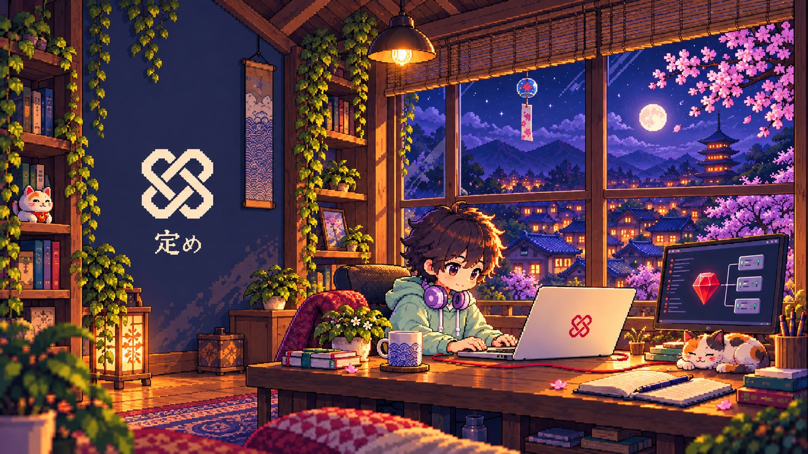
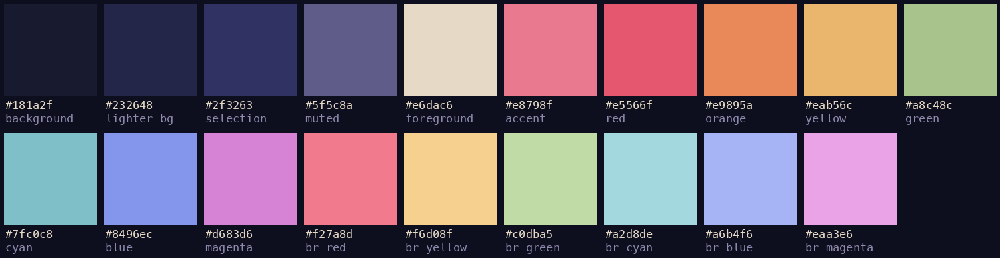

# Sadame for Omarchy

A dark [Omarchy](https://omarchy.org) theme for [Sadame](https://enderkus.github.io/sadame/),
the configuration management tool in plain Ruby.

Night-indigo walls, sakura pink, lamp-lit amber and the red Sadame knot. The brand
red `#bd304c` and its dark-mode pink `#e8798f` come straight from the Sadame docs;
the rest of the palette is sampled from the pixel-art wallpaper.



## Install

```bash
omarchy theme install https://github.com/enderkus/omarchy-sadame-theme
```

Or use _Install > Style > Theme_ in the Omarchy menu (`Super + Alt + Space`) and paste the
repository URL. The theme appears as **Sadame** in the theme picker (`Super + Ctrl + T`).

## What's inside

| File | Purpose |
| --- | --- |
| `colors.toml` | The palette. Omarchy generates the terminal, Neovim, btop, Chromium, Hyprland, VS Code and shell colours from it. |
| `backgrounds/` | The Sadame pixel-art room, plus a quiet knot wallpaper. Switch with `Super + Ctrl + W`. |
| `icons.theme` | `Yaru-red` file-manager icons, to match the knot. |
| `unlock.png` | The Sadame knot for the boot unlock screen. Pick it under _Appearance > Unlock_. |
| `preview-unlock.png` | Preview of that unlock screen. |

Window borders run from the Sadame red into the sakura pink.

## Palette



| Role | Hex | | Role | Hex |
| --- | --- | --- | --- | --- |
| background | `#181a2f` | | foreground | `#e6dac6` |
| dark background | `#131527` | | light foreground | `#efe4d1` |
| darker background | `#0e0f1e` | | bright foreground | `#fbefdc` |
| lighter background | `#232648` | | dark foreground | `#8e89ad` |
| selection | `#2f3263` | | accent | `#e8798f` |
| muted | `#5f5c8a` | | brown | `#8f4b3e` |
| red | `#e5566f` | | bright red | `#f27a8d` |
| orange | `#e9895a` | | | |
| yellow | `#eab56c` | | bright yellow | `#f6d08f` |
| green | `#a8c48c` | | bright green | `#c0dba5` |
| cyan | `#7fc0c8` | | bright cyan | `#a2d8de` |
| blue | `#8496ec` | | bright blue | `#a6b4f6` |
| magenta | `#d683d6` | | bright magenta | `#eaa3e6` |

Every text colour clears WCAG AA (4.5:1) against the background; the foreground sits at 12.4:1.

## License

[MIT](LICENSE). The Sadame name, knot and wallpaper belong to the Sadame project.
